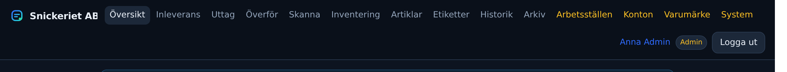
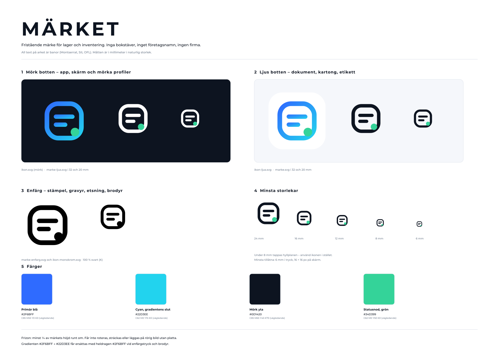

# Lansering och vitmärkning – så säljs Tadega Lager till andra företag

## 1. Tre sätt att leverera samma produkt

| Form | Vem passar den | Vad kunden får |
|---|---|---|
| **Webb (PHP)** | Företag med eget webbhotell eller där man vill nå appen från valfri enhet | Egen subdomän, HTTPS, mobil + dator, backup på servern |
| **Skrivbordsapp (Electron)** | Lagerlokaler med Windows-PC, Mac eller Linux och krav på lokal lagring | Eget program med systray, lokal datamängd, inget internetberoende |
| **Båda** | Företag med kontor + lager | Samma varumärke i båda – men **separata datakataloger** (se avsnitt 6) |

Appens affärslogik finns bara i PHP-koden. Skrivbordsappen startar samma PHP-kod lokalt.
Det betyder att varje regel (saldo, QR-enheter, avstämning, roller) uppför sig identiskt i båda formerna.

---

## 2. Vitmärkning – det som ska bytas per kund

Allt nedan görs **utan att röra koden**:

| Vad | Var | Kommentar |
|---|---|---|
| Företagsnamn | Admin → Varumärke | Visas i meny, sidfot, etiketter, inloggning |
| Logotyp (SVG) | Admin → Varumärke → Ladda upp | Saneras automatiskt; skript och externa länkar tas bort |
| Färger | Admin → Varumärke | Primär, accent, bakgrund – gäller hela gränssnittet |
| Tema | Admin → Varumärke | Mörkt eller ljust |
| Ordval | Admin → Varumärke | T.ex. "butik" i stället för "arbetsställe" |
| Arbetsställen | Admin → Arbetsställen | Örebro/Laxå finns bara som startförslag i installationen |
| Appikon | `brand/ikoner/` + Admin → Varumärke | Ersätts före bygge av skrivbordsappen |

**Viktigt:** logotypen laddas upp som SVG och sparas i `storage/varumarke/` som är privat.
Den serveras via `/varumarke/logotyp.svg` med korrekt Content-Type – aldrig som rå fil.

### Kontroll av varumärket

1. Logga in som admin → Varumärke → ladda upp kundens SVG.
2. Sätt namn och färger → **Spara** → ladda om sidan.
3. Öppna `/etiketter`, skriv ut en provetikett: namn och etikettmall följer varumärket.
4. System → skapa backup.

---

## 3. Märket och varumärkesfilerna (för tryck och marknadsföring)

### Märket är fristående

Symbolen är en **hylla sedd framifrån**: en rundad ram med två hyllplan och en
grön statusnod i nedre höger hörn.

- **Inga bokstäver.** Inget T, ingen initial, inget monogram.
- **Inget företagsnamn.** Märket nämner ingen firma och ingen produkt.
- Det fungerar därför för vilken installation som helst – även efter
  vitmärkning – och kan användas av kunden i egen marknadsföring.
- Den gröna noden är samma punkt som appen använder för "i lager": hyllan visar
  vad appen gör, noden att enheten är kontrollerad.

I appen ritas märket som inline-SVG med varumärkets färger. Företagsnamnet står
som **text bredvid** symbolen – det är alltså inte en del av märket, och byts ut
när kunden byter namn. Ingen logotypfil behöver ritas om vid vitmärkning.



### Filerna

Allt ligger i `brand/` och är ren SVG med mått i mm. **Tryckoriginalen följer
med varje release** – de ligger i installationspaketet och i skrivbordsbygget,
och laddas ner i appen under **Admin → Varumärke → Tryckoriginal** (en zip med
allt). Det finns ingen lös fil att hålla reda på.

| Fil | Användning |
|---|---|
| `tryck/marke-tryckark.svg` | **Färdigt A3-ark** med alla varianter, storlekar, färgprover och regler – skicka den till tryckeriet |
| `ikon.svg` | Appikon på mörk botten |
| `ikon-ljus.svg` | Appikon på ljus botten |
| `ikon-monokrom.svg` | Tray-ikon, etsning, en färg |
| `marke.svg` / `marke-ljus.svg` | Märket utan bakgrund (favicon, dekal, tryck) |
| `marke-enfarg.svg` | Stämpel, gravyr, brodyr |
| `etikett-80x50.svg` | Etikettmall för termisk etikettskrivare 80 × 50 mm |
| `ikoner/` | PNG i 16–1024 px, `.ico` för Windows, `trayTemplate` för macOS |



### Trycktekniska krav

- **Format:** SVG 1.1, `viewBox` satt, mått i mm på tryckarket. Öppnas i
  Illustrator, Inkscape, Affinity.
- **Färger:** `#2F6BFF` (primär), `#22D3EE` (gradientens slut), `#0D1420`
  (mörk yta), `#34D399` (statusnod). CMYK-värden finns på tryckarket
  (vägledande – be tryckeriet konvertera).
- **Minimistorlek:** 6 mm i tryck, 16 × 16 px på skärm. Under 8 mm tappas
  hyllplanen – använd då ikonen.
- **Frizon:** minst ¼ av märkets höjd runt om.
- **Får inte:** roteras, sträckas, läggas på rörig bakgrund utan platta, byta
  färg utanför listan. Vid enfärgstryck och brodyr används heldragen `#2F6BFF`
  i stället för gradienten.

### Ändra märket själv

```bash
python3 brand/skapa-varumarke.py     # märke, ikon och etikettmall
python3 brand/exportera-ikoner.py    # PNG/ICO/tray (kräver cairosvg + Pillow)
python3 brand/skapa-tryckark.py      # tryckark A3
php bin/backup.php                   # varumärkesfilerna följer med i backupen
```

## 4. Bygga skrivbordsappen

### Förberedelse (en gång per byggmaskin)

```bash
cd desktop
npm install                # electron + electron-builder
```

### Kör i utvecklingsläge

```bash
npm start                  # kräver PHP 8.1+ i PATH
```

### Bygg installationsfiler

```bash
npm run bygg:win           # NSIS-installerare + portabel .exe (körs på Windows)
npm run bygg:mac           # .dmg + .zip (körs på macOS, helst både Intel och Apple Silicon)
npm run bygg:linux         # AppImage + .deb
```

Resultatet hamnar i `desktop/release/`. Filnamnet innehåller version, OS och arkitektur.

### Krav per plattform

| Plattform | Krav | Not |
|---|---|---|
| Windows 10/11 | x64 | PHP krävs i PATH om det inte buntas in (se nedan) |
| macOS 11+ | Intel + Apple Silicon | Notiser i menyraden, appen lever kvar utan fönster |
| Linux | AppImage: de flesta; .deb: Debian/Ubuntu | Wayland stöds via Electron |

### Bunta in PHP (så att kunden slipper installera det)

Lägg en portabel PHP i `desktop/php/bin/` före bygget:

```
desktop/php/bin/php        (macOS/Linux)
desktop/php/bin/php.exe    (Windows)
```

Skrivbordsappen letar där först, sedan i PATH. Använd en statiskt byggd PHP 8.3 med
`json`, `mbstring`, `openssl` och `zip`.

`desktop/package.json` packar in `../app`, `../bin`, `../public` och `../brand`.
Vill ni även bunta in PHP läggs detta till i `build.extraResources`:

```json
{ "from": "php", "to": "php" }
```

**Rättigheter och källor:** Electron, Chromium och PHP distribueras under egna licenser.
Vid försäljning ska dessa licenser följa med installationen. Lägg en `LICENSER.txt`
i `desktop/build/` med Electron (MIT), Chromium (BSD-3), Node (MIT) och PHP (PHP License 3.01)
samt behåll `brand/fonts/OFL.txt` för Montserrat.

### Hur systray beter sig

| Åtgärd | Windows / Linux | macOS |
|---|---|---|
| Stäng fönstret (X) | Minimera till systemfältet, appen lever kvar | Fönstret döljs, appen lever kvar |
| Vänsterklick på ikonen | Öppna fönstret | Öppna fönstret |
| Högerklick | Meny: Öppna, Öppna i webbläsare, Datakatalog, Logg, Avsluta | Samma meny |
| Första gången X trycks | Notis: "Appen körs kvar i systemfältet" | – |
| Avsluta | Endast via menyn | Endast via menyn (Cmd+Q) |

### Var skrivbordsappens data ligger

| OS | Datakatalog |
|---|---|
| Windows | `%APPDATA%\Tadega Lager\storage\` |
| macOS | `~/Library/Application Support/Tadega Lager/storage/` |
| Linux | `~/.config/Tadega Lager/storage/` |

Katalogen öppnas från tray-menyn. Den innehåller `data/`, `backup/`, `journal/` med mera –
exakt samma struktur som webbversionen.

---

## 5. Checklista före leverans till kund

- [ ] `php bin/installera.php --namn="Kund Namn" --pin=xxxx` skapad
- [ ] Arbetsställen inlagda och arbetsplats-QR utskrivna
- [ ] Kundens logotyp uppladdad och kontrollerad i meny **och** etikettutskrift
- [ ] Färger kontrollerade på projektor/skärm i lagerlokalen
- [ ] Testartikel skapad, en etikett utskriven och skannad med mobilkamera
- [ ] **Tryckoriginal** hämtade från Admin → Varumärke → Tryckoriginal och skickade till tryckeriet
- [ ] Kontrollerat att märket står fristående (inga bokstäver, inget företagsnamn)
- [ ] `php bin/backup.php` körd, återläsning provad med `--till-testkatalog`
- [ ] `php bin/verifiera-historik.php` säger "Kedjan är intakt"
- [ ] Test SÄK-01–SÄK-06 körda i kundens HTTPS-miljö
- [ ] Personal konto skapat och provat: kan göra uttag men inte nå `/konton`
- [ ] Avstämning provad med en medveten differens (och därefter återställd)

---

## 6. Två installationer ska inte dela data

Webbversionen och skrivbordsappen är separata installationer med var sin datakatalog.
Det är medvetet: de kan inte skriva i samma JSON-filer utan att riskera att en
skrivning skriver över den andra.

Vill kunden ha båda:

1. Kör **en** av dem som huvudinstallation (där data matas in).
2. Använd backup + `bin/aterlas.php --skriv-till-drift --ja-jag-vet-vad-jag-gor` för
   att flytta data vid behov, eller
3. Vänta på fas 2:s synkronisering (utanför första fasen enligt kravspecen).

---

## 7. Licensiering och försäljning – praktiska punkter

Koden är kundens/återförsäljarens att driftsätta. För att kunna sälja som produkt bör man
komma överens om:

- **Licensnyckel per installation** (fältet `licens` finns redan i `varumarke.json`).
  Kontrollera den i `bootstrap.php` om ni vill ha en spärr – men undvik att låsa kundens
  lagerdata; appen ska alltid kunna läsa och exportera sin egen data.
- **Supportavtal** – support-e-post visas för personal i gränssnittet.
- **Uppdateringsrutin** – skrivbordsappen uppdateras genom att installera ny version;
  datakatalogen ligger kvar orörd.
- **Varumärkesrätt** – kontrollera att kundens logotyp får användas i tryck (skriftligt ok).

Enkel licenskontroll (frivillig, fas 2): läs `licens_utgang` i `varumarke.json` och visa
en varning i adminpanelen 30 dagar innan utgång. Blockera aldrig utskrifter eller avstämning.

---

## 8. Artikel-QR – etikett per artikel

Skillnaden mot enhetsetiketterna:

| | Enhetsetikett | Artikel-QR |
|---|---|---|
| Sitter på | En fysisk enhet | Hyllkant, låda, artikel |
| QR innehåller | Enhetskoden `TDL-U-…` | En länk till artikelns sida |
| Vid skanning | Enheten identifieras i appen | Artikelns sida öppnas (bilder + antal) |
| Antal etiketter | En per enhet | En per artikel (kan skrivas ut flera) |

### Så fungerar flödet

1. Admin/chef skapar etiketterna: **Artiklar → [artikel] → Artikel-QR** eller
   **Etiketter → Artikel-QR**. Välj antal, välj rullbredd och skriv ut.
2. Medarbetaren skannar koden med telefonens kamera. Kameran öppnar den
   **publika artikelsidan** direkt i webbläsaren – ingen app behöver installeras.
3. Sidan visar artikelns bilder och saldo för valt arbetsställe.
4. För att ändra antal krävs inloggning – tryck **Logga in**, ange namn och PIN.
5. Därefter finns **+ 1**, **− 1** och ett fält för annat antal med valfri kommentar.
6. Allt går genom samma regler som i appen: allt-eller-inget, historik, uttagsspärr.

### Tre sätt att skanna – och vad som gäller var

Det finns två helt olika sorters QR i appen, och de skannas på olika sätt:

| QR | Innehåller | Skannas med | Kräver |
|---|---|---|---|
| **Artikel-QR** (på hyllkant/låda) | En **länk** till artikelns sida | Vanliga **mobilkameran** – ingen app | Att telefonen når appens adress (samma nät eller publik server) |
| **Enhets-QR** (på varje fysisk enhet) | En **kod** `TDL-U-…` | Appens egen skanner: **Skanna → Starta kamera** | Inloggning i appen |
| **Arbetsplats-QR** | En platskod `P65D9` | Appens egen skanner | Inloggning i appen |

**Artikel-QR – mobilkameran räcker.** Koden innehåller en fullständig adress med
signatur, så IOS-kameran, Android-kameran eller vilken QR-läsare som helst öppnar
artikelsidan direkt i webbläsaren. Ingen inloggning krävs för att **se** bilder
och saldo; inloggning krävs först när man ändrar antal.

**Enhets-QR och plats-QR – appens skanner.** Där ligger koden som *text*
(`TDL-U-…`), inte som en länk. Den läses i appen under **Skanna**: tryck
**Starta kamera**, rikta mot koden, och appen slår upp enheten eller platsen.
Samma fält tar emot koden manuellt om kameran inte fungerar.

### Så fungerar kameran tekniskt

- Kameran är **avstängd tills man trycker på knappen** – ingen kamera startas i
  bakgrunden. Den stängs av direkt när en kod lästs.
- Avläsningen sker **i webbläsaren** med `getUserMedia` + jsQR. Ingen bild eller
  video skickas någonstans; bara den avlästa koden går vidare till servern.
- **HTTPS krävs.** Webbläsare (särskilt iOS Safari) tillåter bara kamera i säkra
  sammanhang – `https://` eller `localhost`. Över ren `http://` på en IP-adress
  nekar webbläsaren, och appen visar då "Kameran kräver HTTPS".
- Fungerar inget av det: skriv koden i fältet **Eller skriv koden manuellt**.

**Detta gäller även förhandsgranskningen:** den går över `https://` via proxyn,
men kameran där är *datorns* kamera. Riktig testning av kameraskanningen görs på
en telefon mot appens riktiga adress.

### Skriva ut på etikettskrivare

Etiketten är gjord för att sitta på **hyllkanten eller lådan** och visa artikelnamnet
tydligt – den som står framför hyllan ska se vad som finns utan att skanna.

| Steg | Gör så här |
|---|---|
| 1 | Mät etiketten på rullen – måttet står ofta på baksidan av pappersrullen |
| 2 | Välj samma mått i listan **Etikettstorlek** (förval 62 × 29 mm) |
| 3 | Kontrollera förhandsvisningen – den visas i exakt tryckstorlek |
| 4 | Välj skrivaren i utskriftsdialogen och sätt marginalerna till **Inga** |
| 5 | Stäng av "Anpassa till sidan" / "Fit to page" – appen har redan rätt mått |

**Vad etiketten innehåller**

```
┌──────────────────────┬────────────────────────┐
│                      │  Skruvdragare 18V      │  ← namnet, fetstil
│      QR-KOD          │  ▐█▌▐██▌▐█▐▌▐██▌▐█▌    │  ← streckkod (Code 39)
│     (24 mm)          │  7312345678901         │  ← artikelnummer
│                      │  Tadega Lager          │  ← företagsnamn
└──────────────────────┴────────────────────────┘
```

- **QR-koden** öppnar artikelns sida med bilder och antal. Felkorrigering L ger grövre rutor
  som skrivaren klarar av.
- **Streckkoden** (Code 39) finns för att många handscanners i lager bara läser streckkod.
  Den byggs av artikelnumret och visas bara om numret bara innehåller `0-9 A-Z - . mellanslag`.
  Har du egna EAN-koder fungerar de att skriva ut som de är.
- **Namnet** visas med fetstil och bryts över två rader. Långa namn kortas.
- **Inget dubbelt nummer** – artikelnumret står en gång, under streckkoden.

**Rullbredder som stöds:** 62 × 29, 62 × 100, 50 × 25, 89 × 36 mm samt A4-ark.
Behöver du en annan rulle läggs den till i `app/views/artikel_etiketter.php` (`$rullar`).

**Vanliga problem**

| Symptom | Orsak | Lösning |
|---|---|---|
| Utskriften blir A4 med mycket vitt | Skrivarens pappersformat vinner | Välj rätt pappersstorlek i skrivardrivrutinen |
| Etiketten delas mitt i QR-koden | Fel rullhöjd vald | Byt höjd i listan, skriv ut igen |
| QR-koden går inte att skanna | För liten utskrift eller för torrt papper | Välj större rulle (62 × 100 ger 42 mm QR) |
| Marginal på varje etikett | Marginalerna är kvar i dialogen | Sätt marginalerna till **Inga** |
| Texten hamnar utanför etiketten | "Anpassa till sidan" är på | Stäng av den |

### Länken är signerad

QR-länken innehåller en kontrollsumma som räknas fram ur en nyckel som bara servern känner.
Utan giltig signatur visas en felsida. Det gör att:

- vem som helst kan **läsa** artikeln och se bilder (bra för lagerpersonal utan konto),
- ingen kan **gissa** sig till andra artiklar eller ändra antal utan att vara inloggad,
- admin kan **spärra alla utskrivna koder** genom att byta nyckel under *System → Byt QR-nyckel*.

### Ställ in adressen först

QR-koden måste innehålla en fullständig webbadress. Ange appens publika adress under
**System → Artikel-QR – adress och nyckel** (t.ex. `https://lager.foretag.se`).
I skrivbordsappen används den lokala adressen, som bara fungerar på samma datornät.

### Bilder

- Laddas upp på artikelkortet (JPG, PNG, WebP, max 8 MB, max 12 per artikel).
- Skalas automatiskt ner till 1600 px om GD finns.
- Ligger i `storage/bilder/<artikel-id>/` – utanför webbroten och nås bara med inloggning
  eller en giltig signerad QR-länk.
- Kan läggas till från mobilen direkt i den publika vyn (inloggning krävs).

### Fungerar på alla mobiler

Sidan är en vanlig webbsida – ingen app ska installeras för att visa eller ändra.
Den fungerar i Safari (iPhone/iPad), Chrome, Firefox, Edge och Samsung Internet.
Knapparna har minst 44 px träffyta och formulären har `inputmode="numeric"` så
siffertangentbordet öppnas för antal och PIN.
