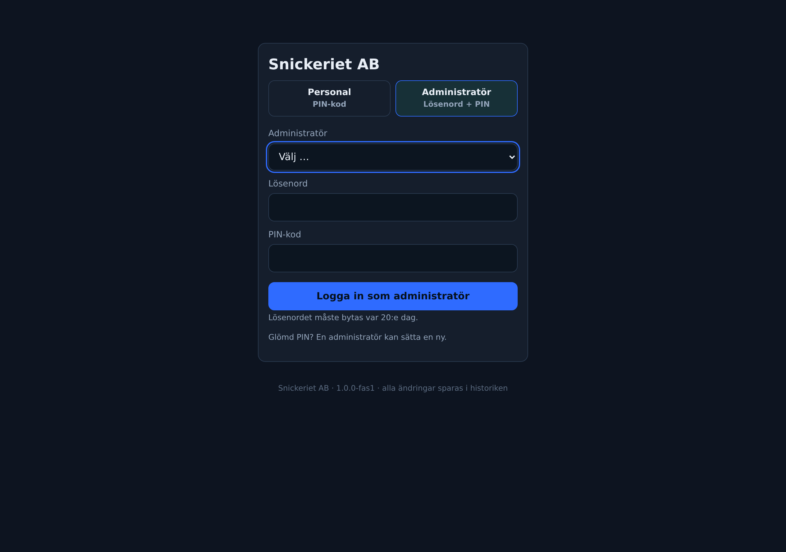
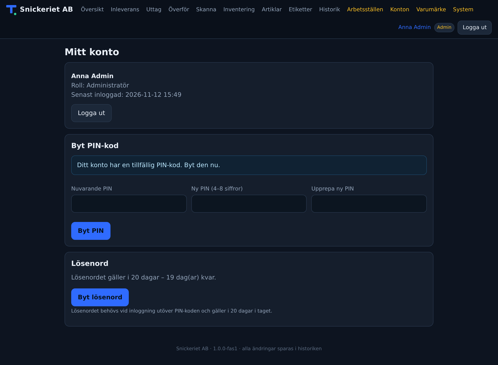
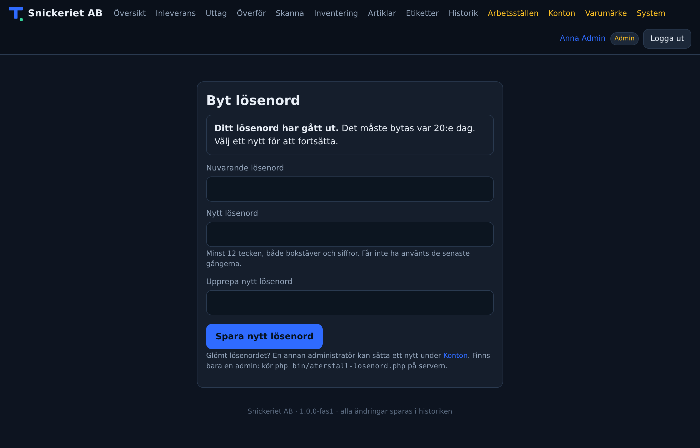
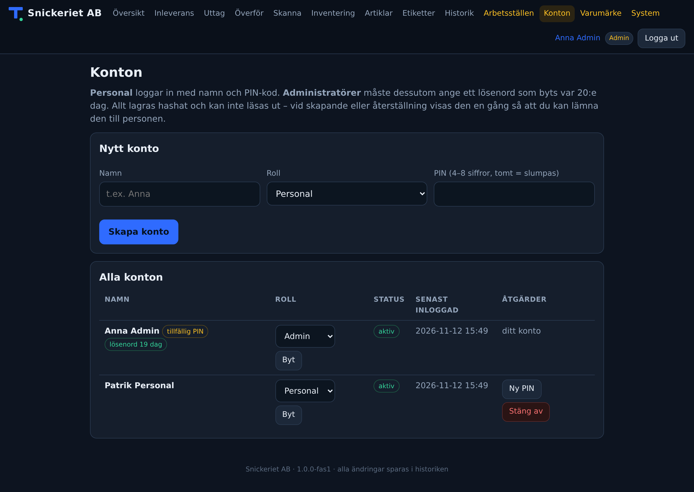

# Inloggning: PIN för personal, lösenord för admin

*Uppdaterad 2026-11-12. Gäller från version 1.0.0-fas1.*

## Varför två olika sätt att logga in

Lagerpersonalen står vid hyllan med handskar på och telefonen i handen. Där är en
fyrsiffrig PIN snabbast. Administratören sitter vid datorn och kan ändra priser,
radera artiklar och byta QR-nyckel – där behövs något starkare. Därför:

| Roll | Krävs vid inloggning | Byte |
|---|---|---|
| **Personal** | PIN-kod, 4–8 siffror | När som helst, under *Mitt konto* |
| **Administratör** | PIN-kod **och** lösenord (minst 12 tecken) | Lösenordet **måste** bytas var 20:e dag |

PIN-koden ensam räcker alltså aldrig för en administratör. Det skyddar mot att
någon som sett PIN-koden över axeln kan gå in och ändra i lagret.

## Så ser det ut

**Inloggningssidan** har två flikar. Personal väljer sitt namn och slår PIN-koden.
Administratören väljer sitt namn, skriver lösenord och slår PIN-koden.



## Regler för lösenordet

* Minst **12 tecken**.
* Både **bokstäver och siffror**.
* Får inte vara ett av de vanligaste lösenorden (ordet självt, `123456`, `qwerty` …).
* **Ingen återanvändning**: de senaste 8 lösenorden spärras. Servern sparar bara
  SHA-256-hashar av dem, aldrig lösenorden i klartext.
* Giltigt i **20 dagar**. Därefter måste det bytas – inloggningen leder då direkt
  till bytessidan och ingen annan sida går att nå förrän bytet är gjort.
* **5 dagar innan** det går ut visas en gul varning överst på varje sida, med
  direktlänk till bytet.



## Tvångsbyte

När lösenordet har gått ut ser administratören bara bytessidan. Den nås på
`/mitt-konto/losenord`. Där anges nuvarande lösenord en gång, därefter det nya
två gånger. Efter bytet fungerar allt som vanligt igen och nedräkningen börjar om
på 20 dagar.



## Administrera lösenord åt andra

Under **Konton** (endast admin) visas varje administratörs lösenordsstatus:

| Märkning | Betydelse |
|---|---|
| `lösenord 19 dag` | Grönt – gott om tid kvar |
| `lösenord 3 dag` | Gult – byt snart |
| `lösenord utgånget` | Rött – kontot måste byta vid nästa inloggning |
| `inget lösenord` | Rött – kontot kan inte logga in förrän ett lösenord satts |

Knappen **Nytt lösenord** sätter ett nytt lösenord åt en annan administratör.
Servern skapar då ett slumpat lösenord som visas **en gång** i klartext efteråt –
skriv upp det och lämna över, be kollegan byta det vid första inloggningen.



## Glömt lösenordet

**Finns en annan administratör:** hen sätter ett nytt lösenord under *Konton*.

**Finns bara en administratör:** kör nödskriptet på servern:

```bash
php bin/aterstall-losenord.php                      # listar alla admins och deras status
php bin/aterstall-losenord.php --namn="Anna Admin"  # sätter ett nytt, slumpat lösenord
```

Skriptet skriver ut det nya lösenordet en gång. Det kräver åtkomst till serverns
filsystem, så det kan inte missbrukas utifrån. Glöm inte att byta lösenordet direkt
efter inloggning.

## För den som installerar

Vid första installationen (`/installera`) anges förutom namn och PIN även
administratörens lösenord. Det måste uppfylla samma krav och räknas från dag ett.

## Tekniskt

| Del | Fil |
|---|---|
| Regler, hashing, historik, utgångsdatum | `app/Support/Konto.php` |
| Inloggning och lösenordssida | `app/Http/Installation.php` |
| Inloggningsvyn med flikar | `app/views/login.php` |
| Bytessidan | `app/views/losenord.php` |
| Tvångsbyte i routingen | `public/index.php` |
| Nödskript | `bin/aterstall-losenord.php` |

Lösenord hashas med `password_hash()` (bcrypt). Utgångsdatumet räknas från fältet
`losenord_satt`. Spärren för återanvändning jämför SHA-256-hashar i
`losenord_historik` (max 8 poster). Alla byten loggas i historiken som
`losenord_andrat` med kontots id och namn – aldrig med lösenordet.

### Automatiska prov

| Prov | Kontrollerar |
|---|---|
| LO-01 | 12 tecken, bokstäver och siffror, vanliga lösenord nekas |
| LO-02 | Personal kan inte tilldelas lösenord |
| LO-03 | Admin utan lösenord nekas; fel lösenord nekas |
| LO-04 | Utgång efter 20 dagar samt varning 5 dagar innan |
| LO-05 | Återanvändning av gamla lösenord nekas |
| LO-06 | Bytet kräver nuvarande lösenord (utom när admin sätter åt annan) |
| LO-07 | Personal loggar in med enbart PIN |

Kör alla prov med `php tests/integrationstest.php` (45 prov, alla ska vara gröna).
