# Larm, säkerhet och arkiv

*Uppdaterad 2026-11-12. Bygger förslag 3, 4 och 5 i `08_25-forbattringar.md`.*

Tre saker som hör ihop: att märka när det tar slut, att hindra att saker försvinner
obemärkt, och att kunna visa i efterhand vad som faktiskt hände.

---

## 1. Miniminivålarm – "det tar slut snart"

Varje artikel kan ha en **miniminivå**. Fram till nu var den bara en siffra i listan.
Nu larmar den.

**På översikten** ligger en rad överst:

> **8 artiklar ligger under miniminivå. 5 av dem är helt slut.** *Visa listan →*

Raden är gul när något fattas och grön när allt är över nivå. Den syns för både
personal och admin – det är personalen som fyller på.

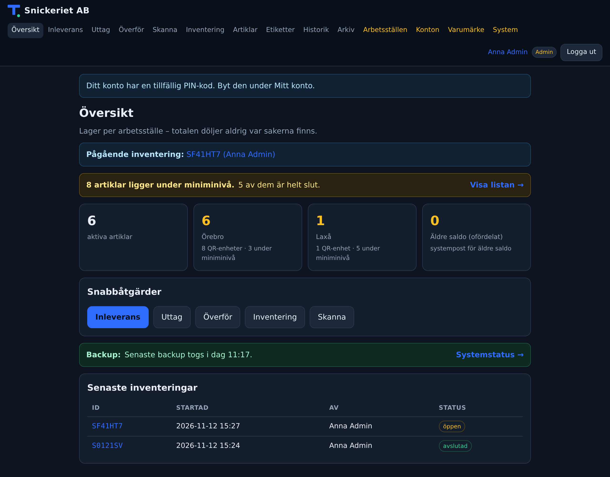

**Larmsidan** (`/miniminiva`) listar varje kombination av artikel och arbetsställe:

| Artikel | Arbetsställe | Saldo | Miniminivå | Brist | Åtgärd |
|---|---|---|---|---|---|
| Plastplugg 8 mm | Laxå | **0 st** | 700 | 700 | *Fyll på* |
| Mutter M8 | Laxå | **0 st** | 200 | 200 | *Fyll på* |
| Plastplugg 8 mm | Örebro | 640 st | 700 | 60 | *Fyll på* |

Sorterat på **största brist först** – det är där det tar slut snabbast.
*Fyll på* går direkt till inleveransformuläret med artikel och arbetsställe förvalda.

Saldot räknas **per arbetsställe**, precis som resten av appen. En artikel kan vara
slut i Laxå men full i Örebro – då är det bara Laxå som larmar.

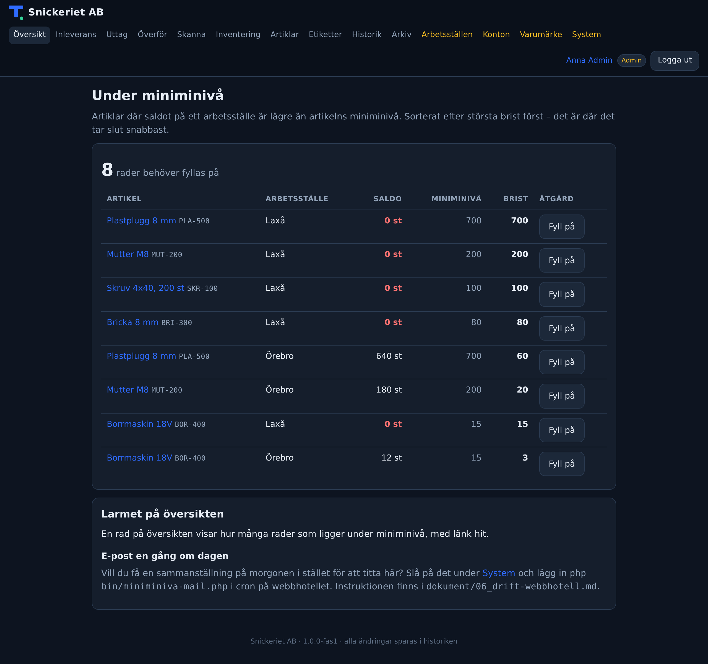

### E-post en gång om dagen (valfritt)

Kräver att webbhotellet tillåter `mail()`. Slå på under **System → Larm och säkerhet**,
ange mottagare och lägg i cron:

```bash
30 6 * * 1-5  php /hem/snickeriet/bin/miniminiva-mail.php
```

Testa först utan att skicka:

```bash
php bin/miniminiva-mail.php --visa
```

---

## 2. Tvåpersonersregel – för stora uttag

En person ska inte kunna bära ut halva lagret utan att någon ser det.

**Så fungerar det:** uttag som når en gräns måste bekräftas av en **kollega med sin
PIN-kod**. Kollegan behöver inte vara admin – det räcker att hen är ett aktivt konto
och inte samma person som gör uttaget.

Gränsen sätts under **System → Larm och säkerhet** och kan vara:

* **antal enheter** – t.ex. 100 st eller mer, eller
* **värde i kronor** – t.ex. 5 000 kr eller mer, räknat på artikelns prisreferens.

Båda kan vara aktiva samtidigt. **0 i båda fälten = regeln är av.**

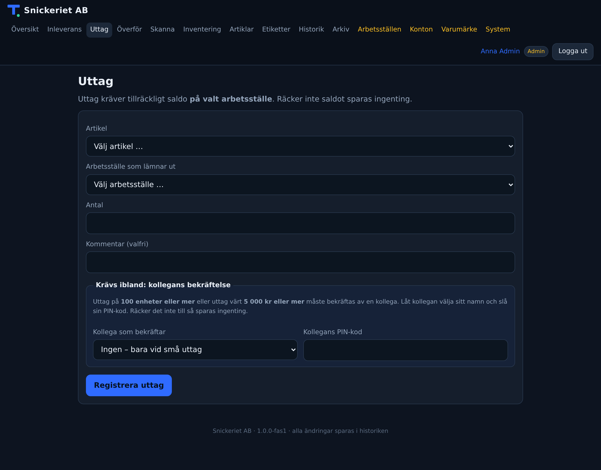

Vid uttaget:

1. Personalen väljer artikel och antal som vanligt.
2. Kollegan väljer sitt namn i listan och slår **sin** PIN-kod.
3. Utan godkännande sparas **ingenting** – uttaget avvisas med en förklaring:
   *"Det här uttaget kräver att en kollega bekräftar med sin PIN-kod (uttag över 100 enheter)."*
4. Man får inte godkänna sitt eget uttag.

I historiken sparas vem som godkände:

```json
{ "typ": "uttag", "antal": 120, "godkand_av": { "id": "…", "namn": "Patrik Personal" } }
```

och kvittensen efteråt säger *"Uttag registrerat: 120 styck. Bekräftat av Patrik Personal."*

**Råd:** sätt hellre gränsen på **värde** än på antal. 200 skruvar är ingen fara,
men tre borrmaskiner kan vara det.

---

## 3. Backup med kontroll

`bin/backup.php` har funnits hela tiden men körts manuellt. Nu syns det om den
fungerar.

**Översikten** (endast admin) visar en rad:

> **Backup:** Senaste backup togs i dag 11:17. *Systemstatus →*

Är senaste backup äldre än gränsen blir raden **röd** med uppmaning att kontrollera
schemaläggningen. Gränsen ställs i **System** (1, 2, 3, 7 eller 14 dygn, standard 2).

**Systemstatus** visar samma sak överst, plus antal backuper i arkivet.

Cron på webbhotellet:

```bash
0 3 * * *  php /hem/snickeriet/bin/backup.php
```

---

## 4. Års- och månadsarkiv för inventeringar

**Kravet:** arkivering ska delas per **år och månad** och omfatta **all inventering
över året**.

### Vad som sparas

Varje avslutad inventering fryses som en egen post:

| Fält | Innehåll |
|---|---|
| `session_id` | Inventeringens ID, t.ex. `S0121SV` |
| `plats_namn` | Arbetsstället |
| `startad`, `avslutad` | Tider |
| `startad_av`, `avslutad_av` | Vem som gjorde vad |
| `avstamning` | Hur avvikelserna hanterades |
| `rader[]` | **per artikel**: förväntat, räknat, differens, enhet |
| `antal_artiklar`, `antal_avvikelser` | Summering |

Posten ändras **aldrig** efter att den skapats. Det är därför den går att lita på
i efterhand – även om artikeln sedan byter namn eller tas bort.

### När arkiveringen sker

* **Automatiskt** i samma steg som inventeringen avslutas (både vid avstämning och
  vid "avsluta utan avstämning").
* **Manuellt** med knappen *Arkivera det som saknas* – lägger till äldre avslutade
  inventeringar som saknas. Den ändrar ingenting annat och är säker att köra flera gånger.

### Lagring

```
storage/arkiv/2026/2026-11.json
storage/arkiv/2026/2026-12.json
storage/arkiv/2027/2027-01.json
```

En fil per månad. Det gör att ett år kan läsas överskådligt utan att ladda allt,
och att gamla år kan flyttas undan eller brännas till skiva utan att röra resten.

### I gränssnittet

**Arkiv** i menyn visar:

* **tre siffror överst**: arkiverade inventeringar totalt, antal under valt år, antal avvikelser
* **årsknappar** om det finns flera år
* **tolv månadsrutor** med antal inventeringar och avvikelser per månad
* **månadens lista**: inventering, arbetsställe, avslutad, antal artiklar, avvikelser
* **detaljvy per inventering**: hela artikelnedbrytningen med förväntat, räknat och differens

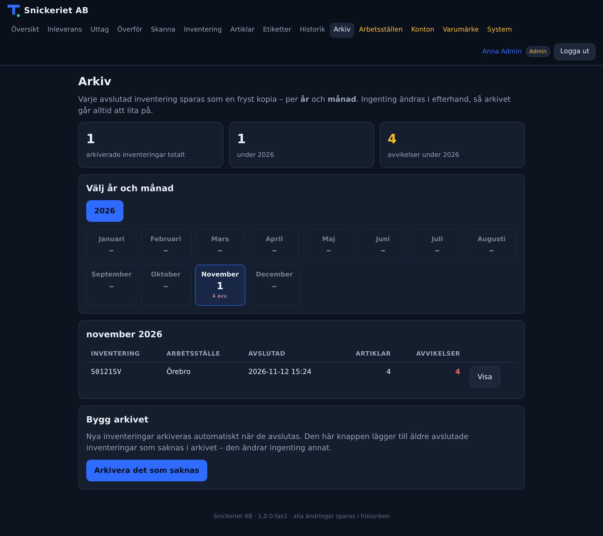

### Säkerhetskopiering av arkivet

Arkivet ligger under `storage/` och följer därför med i `bin/backup.php`.
Kontrollera att `storage/arkiv/` finns med i backupens manifest.

---

## Inställningar (endast admin)

Under **System → Larm och säkerhet**:

| Inställning | Standard | Betydelse |
|---|---|---|
| Visa larmrad på översikten | på | Miniminivålarmet syns |
| Skicka sammanställning per e-post | av | Kräver cron + `mail()` |
| E-postadress | – | Mottagare |
| Tvåpersonersregel, antal enheter | 0 (av) | Uttag som når gränsen kräver kollega |
| Tvåpersonersregel, värde i kronor | 0 (av) | Samma, räknat på prisreferens |
| Backup får vara högst | 2 dygn | Röd varning över gränsen |

Ändringarna loggas i historiken som `installningar_andrade`.

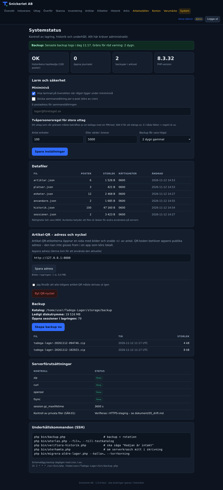

---

## Tekniskt

| Del | Fil |
|---|---|
| Inställningar | `app/Support/Installningar.php` |
| Miniminivåberäkning | `Sidor::underMinimiLista()` |
| Larmsida | `app/views/miniminiva.php` |
| Tvåpersonersregel | `app/Domain/Tvaperson.php` |
| Uttag med godkännande | `Rorelser::uttag(..., ?array $godkannare = null)` |
| Backupkontroll | `app/Support/Backupkontroll.php` |
| Arkivering | `app/Domain/Arkiv.php` |
| Arkivvy | `app/views/arkiv.php` |
| E-postskript | `bin/miniminiva-mail.php` |

Historiktyper: `installningar_andrade`, `backup_skyddad`, `arkiv_skapad`.

### Automatiska prov

| Prov | Kontrollerar |
|---|---|
| MI-01 | Larmlistan hittar brist och räknar rätt |
| MI-02 | Artikel med miniminivå 0 larmar aldrig |
| TP-01 | Stort uttag nekas utan kollega, litet går igenom |
| TP-02 | Kollega godkänner uttaget |
| TP-03 | Godkännaren sparas i historiken |
| TP-04 | Regeln kan stängas av |
| BK-01 | Backupkontrollens lägen |
| AR-01 | Avslutad inventering arkiveras automatiskt |
| AR-02 | Arkivposten har förväntat, räknat och differens |
| AR-03 | Samma session arkiveras bara en gång |
| AR-04 | Arkiveringen delas per år och månad |
| AR-05 | Årssammanställningen räknar ihop året |

---

## 5. Etiketter direkt när artikeln skapas

**Ändrat 2026-11-12:** personal får lägga upp nya artiklar, och etiketterna kan
skapas i samma steg.

### Flödet

1. Personal går till **Artiklar → Ny artikel**.
2. Fyller i namn, enhet och väljer **QR per fysisk enhet**.
3. Anger **antal etiketter** och **arbetsställe**.
4. Klickar *Skapa artikel* → **utskriften öppnas direkt** med etiketterna.

Servern sätter artikelnummer automatiskt (t.ex. `GIP-1` ur namnet) och lämnar
priset tomt – **personal kan inte sätta pris eller artikelnummer**. Admin
justerar det efteråt via *Redigera*.

### Skrivare och etikettstorlek per artikel

Appen skriver ut via **webbläsarens utskriftsdialog**, så den behöver inte kunna
tala med skrivaren – men den måste känna till hur brett skrivhuvudet är. Annars
klipps högerkanten av, eller så hamnar texten utanför en smal rulle.

Skrivaren väljs under **System → Etikettskrivare** (admin). Tryckbredden är
alltid `min(etiketten, skrivarens tryckbredd)`: en 62 mm-etikett skrivs i
60,9 mm på en QL-500, medan en 29 mm-rulle förblir 29 mm bred.

| Skrivare | Tryckbredd | Rullar som passar |
|---|---|---|
| **Brother QL-500 / QL-550** | **60,9 mm** (720 punkter à 300 dpi) | DK-1201 29×90, DK-1202 62×100, DK-1209 29×62, kontinuerlig 62 mm |
| Brother QL-800 / 810W / 820NWB | 58 mm | Samma DK-rullar |
| Dymo LabelWriter 450 / 550 | 56 mm | 99012 36×89, 99010 28×89, 30256 54×101, 11354 57×32 |
| Zebra 2 tum (ZD410 m.fl.) | 56 mm | 50×25, 54×34, kontinuerlig 2 tum |
| Zebra 4 tum (ZD230, ZD421 m.fl.) | 104 mm | 101×152 fraktetikett, 100×50, 62×29 |
| Vanlig skrivare | A4 | A4-ark med 3 kolumner |

Måtten är tillverkarnas angivna **tryckbredd**, inte rullens bredd. Dymo anger
t.ex. 56 mm tryckbredd på en rulle som är 62 mm bred – och en QL-800 skriver
58 mm även om rullen är 62 mm.

**Notation:** alltid **bredd × längd**, där första talet går över skrivhuvudet.
Dymo kallar sin 99012-rulle "89 × 36", men 89 mm är längden. Här skrivs den
`36x89`, annars får den inte plats i en 62 mm pappersbana.

Varje artikel har en **sparad etikettstorlek** (`etikett_mall`) som används
automatiskt när någon skriver ut etiketter för artikeln. Den kan överstyras i
utskriftsvyn utan att artikeln ändras.

| Val i formuläret | Mått (b × l) | Används till |
|---|---|---|
| 62 × 29 mm | standard | hyllkant (vanligast) |
| 62 × 40 mm | kontinuerlig | hyllkant med extra plats |
| 62 × 100 mm | DK-1202 | namnbricka |
| 29 × 90 / 29 × 62 mm | DK-1201 / DK-1209 | adressetikett |
| 36 × 89 / 28 × 89 mm | Dymo 99012 / 99010 | Dymo-adress |
| 54 × 101 mm | Dymo 30256 | Dymo-frakt |
| 57 × 32 mm | Dymo 11354 | FBA-etikett |
| 100 × 50 mm | Zebra 4 tum | hylletikett |
| 101 × 152 mm | 4 × 6 tum | fraktetikett |
| 50 × 25 mm | kontinuerlig | liten lapp |
| Eget mått | 20–112 × 20–1000 mm | valfri rulle |
| A4 | ark, 3 kolumner | vanlig skrivare |

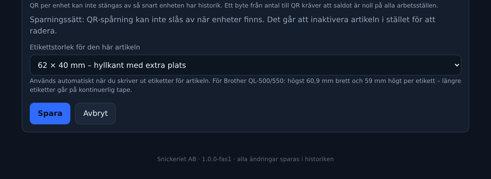

*Etikettstorleken väljs per artikel, och hjälptexten visar vilken skrivare som är vald.*

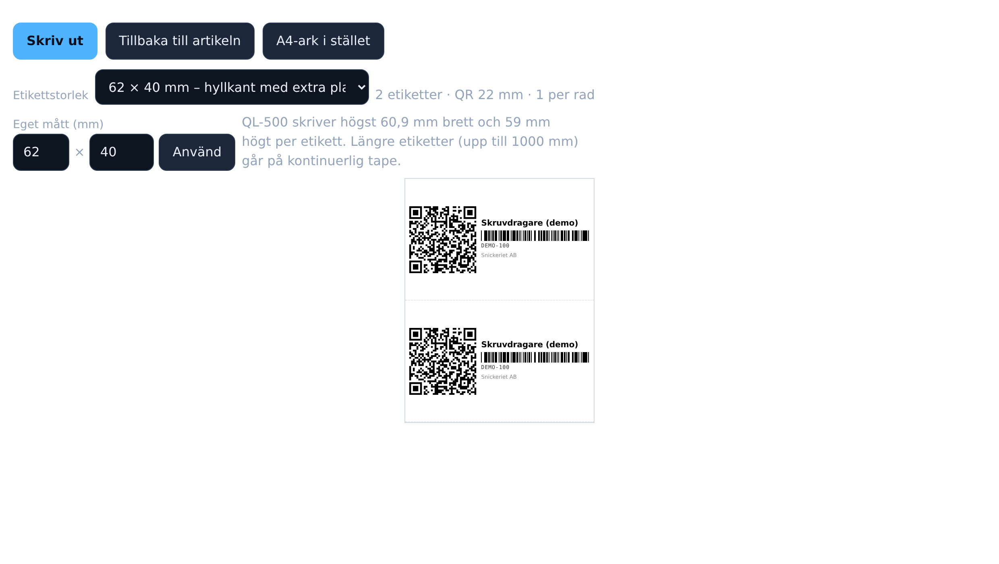

*Utskriftsvyn förväljer artikelns storlek. Eget mått kan anges direkt, och A4-ark finns kvar för vanlig skrivare.*

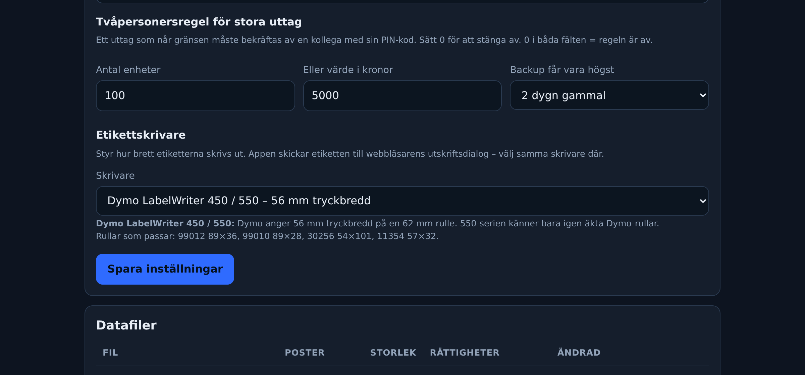

*Skrivaren väljs under System → Etikettskrivare. Hjälptexten visar tryckbredd och vilka rullar som passar.*

Samma etikett på olika skrivare – måtten anpassas automatiskt:

| Brother QL-500, 62 × 29 | Dymo, 36 × 89 | Zebra 4 tum, 101 × 152 |
|---|---|---|
| 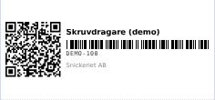 | 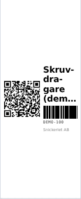 | 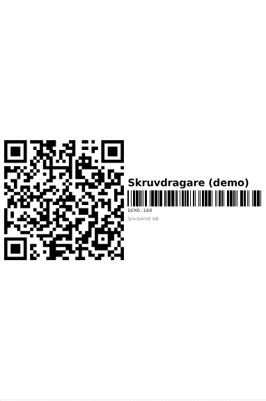 |

Utskriften sätter `@page` till exakt etikettens mått, och etiketten bredd
begränsas till skrivarens tryckbredd.

### Hur etiketten ser ut

**Standard är bara QR-koden och artikelnamnet.** Det är vad personalen läser på
hyllan, och då blir både QR och text större – en 62 × 29-etikett ger **26 mm QR**
i stället för 13 mm när streckkoden tar plats.

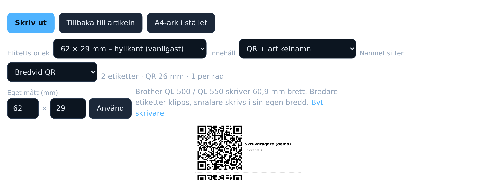

*Etikettstorlek, innehåll och namnets placering väljs direkt i utskriftsvyn.*

Namnet kan placeras på tre sätt, väljs i utskriftsvyn:

| Placering | Används när |
|---|---|
| **Bredvid QR** (standard på breda etiketter) | 62 × 29, 62 × 40, 100 × 50 |
| **Under QR** (standard på smala/höga) | 29 × 90, 29 × 62, 62 × 100 |
| **Över QR** | när man vill ha namnet högst upp |

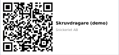

*62 × 29 mm: 26 mm QR och artikelnamnet. Inget mer.*

Vill man ha mer information finns layouten **"QR + namn + nummer + streckkod"**
under *Innehåll* i utskriftsvyn. Då läggs artikelnummer, en Code 39-streckkod och
enhetskoden (`TDL-U-…`) till. Den layouten är bra när en handscanner ska läsa
etiketten i stället för kameran, men den gör QR:en mindre.

| Namnet under QR (62 × 40) | Med streckkod och enhetskod (62 × 29) |
|---|---|
| 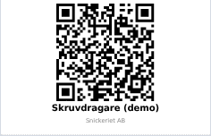 | 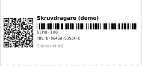 |

**Streckkoden (Code 39)** kräver minst **0,25 mm modulbredd** för att en
handscanner ska läsa den. Blir modulen smalare kortas koden – `DEMO-100` blir
`100` – och en notis på skärmen talar om det. Kortningen klipper vid en
avdelare, aldrig mitt i ett ord. QR-koden bredvid är alltid komplett.

### Arbetsplatsetiketter

Platsens QR skrivs ut på samma rullar, med samma skrivarval. Här finns ingen
streckkod, så QR:en får ta mer plats – men textblocket (namn, kod, regel)
räknas av först, så att etiketten aldrig spiller över på nästa etikett.
Textens höjd går inte att räkna ut exakt i PHP (typsnitt, radbrytningar och
webbläsarens avrundning spelar in). Därför mäts den verkliga höjden i
webbläsaren (`public/assets/platsetikett.js`) och QR:en krymps med precis så
mycket som behövs – aldrig under 12 mm. Utan det steget kunde etiketten spilla
över 4–6 px på nästa, och då klipptes QR:en så att den inte gick att skanna.

| Arbetsplatsetikett 62 × 29 | Arbetsplatsetikett 29 × 90 |
|---|---|
| 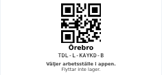 |  |

Om etiketten inte får plats på den valda skrivaren visas en **röd varning** i
utskriftsvyn med förslag på vad man ska göra. Ett mått som ligger utanför
gränserna sparas inte i artikelformuläret – det faller tillbaka på
standardrullen `62x29`, så att en artikel aldrig kan få en etikett som inte går
att skriva ut.

### Vad etiketterna är

Nya etiketter får status `ny` och **påverkar inte saldot**. De räknas in först
när de tas emot via **Inleverans**. Det gör att man kan skriva ut etiketter i
förväg och sätta dem på hyllan innan varan ens kommit.

### Vem får vad

| Åtgärd | Personal | Admin |
|---|---|---|
| Skapa ny artikel | ✅ | ✅ |
| Skapa etiketter | ✅ | ✅ |
| Skriva ut etiketter | ✅ | ✅ |
| Ändra artikel (pris, nummer) | ❌ | ✅ |
| Inaktivera artikel | ❌ | ✅ |
| Skapa/ändra arbetsställe | ❌ | ✅ |
| Konton | ❌ | ✅ |

### Prov

| Prov | Kontrollerar |
|---|---|
| ET-06 | Personal kan skapa etiketter till en ny artikel |
| ET-07 | Etiketterna påverkar inte saldot förrän de tas emot |
| ET-08 | Antalsartiklar kan inte få QR-etiketter |
| ET-09 | Etikettstorleken sparas per artikel; orimliga mått ger standardrullen |
| ET-10 | Skrivarvalet sparas, styr tryckbredden och faller tillbaka på QL-500 om värdet är okänt |
| ET-11 | Streckkoden kortas bara när modulen blir för smal; QR:en förblir komplett |
| ET-12 | Arbetsplatsetiketten ryms på rullen; QR:en krymper aldrig under 12 mm |
| GT-07 | Personal får skapa artikel men inte ändra den |

---

## 6. Förhandsgranskningsläge (testa live utan riktig server)

Appen kan köras i ett **utvecklingsläge** där den går att bädda in i en ram och
logga in i webbläsarens förhandsgranskning. Läget slås på automatiskt när PHP:s
inbyggda webbserver används (`php -S`) och kan styras manuellt:

```bash
TDL_MILJO=utveckling php -S 0.0.0.0:8080 -t public public/index.php
```

| Inställning | Utveckling | Skarp drift |
|---|---|---|
| `X-Frame-Options` | tas bort | `DENY` |
| CSP `frame-ancestors` | `*` | `'none'` |
| Sessions-cookie | används inte | `HttpOnly`, `SameSite=Lax` |
| Sessions-id i adressen | `?tdlagersid=…` läggs på interna länkar, `form action` och redirects | aldrig |
| Cookies | inga | sätts normalt |

**Varför:** i en inbäddad ram på en annan värd räknas cookien som tredjeparts­cookie.
Webbläsaren nekar då både `SameSite=Lax` och `SameSite=None` (som dessutom kräver
`Secure`, vilket saknas över http). I stället skickas sessions-id:t i adressen, precis
som PHP:s `session.use_trans_sid` gör – och formulären fyller på det själva via
`<body data-sid-fraga>` i `public/assets/app.js`.

**Skyddet i skarp drift är oförändrat.** Läget aktiveras aldrig automatiskt på ett
webbhotell: där är `PHP_SAPI` `apache2handler`/`fpm-fcgi`, alltså `produktion`.
Kontrollera med `verktyg/miljokontroll.php` eller genom att `TDL_MILJO` syns som
`produktion` i **System → Systemstatus**.
