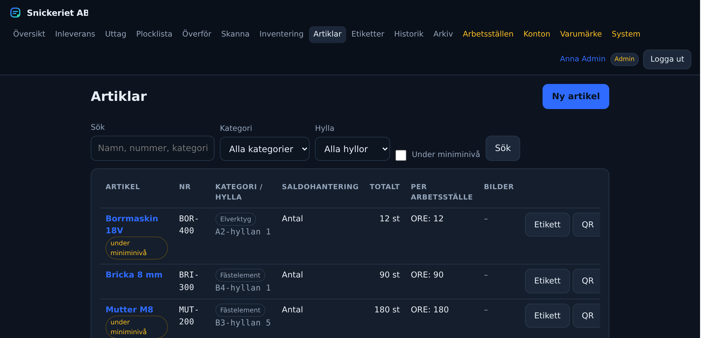
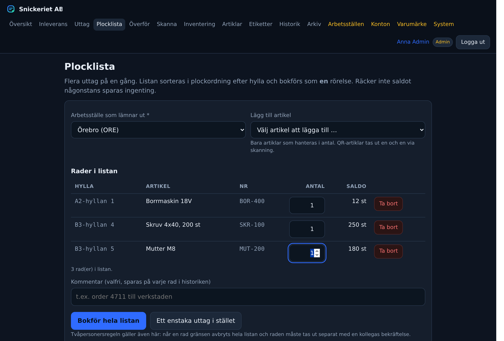
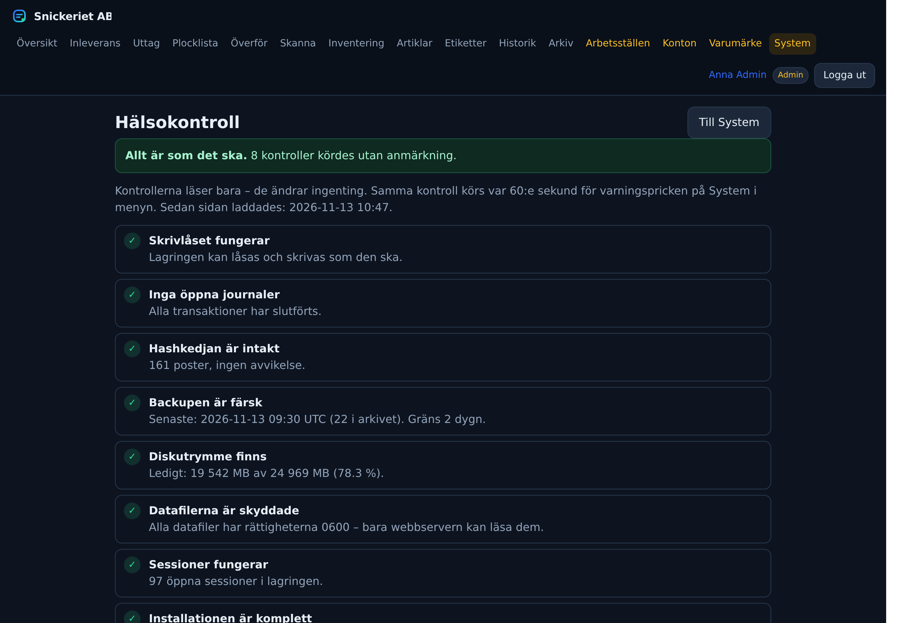
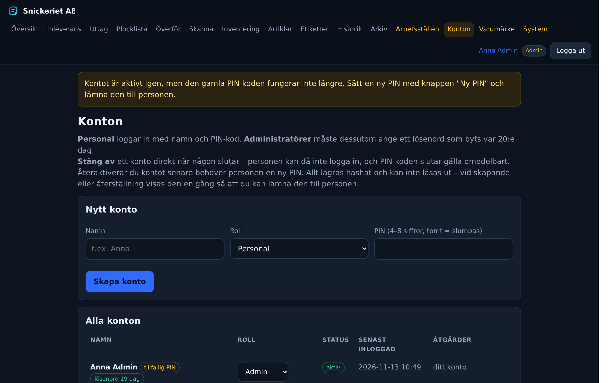

# Genomfört: förslag 1, 3 och 20

**Datum:** 2026-11-13
**Utgångspunkt:** `dokument/12_25-nya-forbattringar.md`
**Provstatus:** 84 godkända / 0 misslyckade (`php tests/integrationstest.php`)
**Historik:** kedjan intakt, 165 poster efter demoinläggningen

De tre förslagen är byggda, provade och live-verifierade i förhandsgranskningen.
Nedan står vad som gör vad, var det finns i koden och vad som är värt att veta.

---

## 1. Kategori och hyllplacering på artikeln

**Vad det gör:** två frivilliga fält på artikeln. **Kategori** skrivs med
autokomplettering från det man redan använt, **hylla** är fritext
(t.ex. `B3-hyllan 4`). Båda blir filter i artikellistan och ingår i sökningen.
Hyllan skrivs ut på etiketten.

**Detaljer som är värda att veta:**

- Tomt fält sparas som `null`, inte som tom sträng – då går "inte satt" att
  skilja från "satt till tomt".
- Blanksteg städas: `"  Fästelement  "` blir `Fästelement`, och
  `"B3-hyllan   4"` blir `B3-hyllan 4`.
- Längden är begränsad till 40 tecken per fält.
- **Hyllsorteringen är numerisk**, inte alfabetisk: `A1, A2, A10, B1` – inte
  `A1, A10, A2`. Samma sortering används av plocklistan, så listan kommer i
  den ordning man faktiskt går genom lagret.
- Artikellistan fick ett fjärde filter: **Under miniminivå**.

**Kod:** `app/Domain/Lager.php` (`valideraPlatsfalt`, `kategorier`, `hyllor`,
`sorteraPaHylla`), `app/views/artikel_form.php`, `app/views/artiklar.php`,
`app/views/artikel.php`, `app/views/artikel_etiketter.php`
(`.hylla`-raden i CSS:en).

**Prov:** KH-01 (spara, städa, neka för långt, behåll vid ändring, historik),
KH-02 (plockordning).

---

## 3. Plocklista – flera uttag i en rörelse

**Vad det gör:** man väljer arbetsställe, lägger till artiklar med antal och
bokför allt på en gång. Listan sorteras automatiskt i plockordning efter hylla.
Resultatet blir **en** sammanfattande historikpost plus en uttagsrad per artikel.

**Allt-eller-inget:** hela listan kontrolleras innan något skrivs. Räcker inte
saldot på en rad avbryts allt med besked om vilken rad det gällde – inget halvt
uttag kan uppstå. Vid avbrott **behålls listan** så att man kan rätta raden i
stället för att skriva om allt.

**Medvetna gränser:**

- Bara artiklar som hanteras i **antal** kan plockas i en lista. QR-artiklar
  måste pekas ut en och en, eftersom varje fysisk enhet ska spåras.
- **Tvåpersonersregeln gäller även här.** Når en rad gränsen avbryts hela
  listan; den raden får tas ut separat med en kollegas bekräftelse. Det är ett
  medvetet val – en lista ska inte kunna kringgå godkännandet.
- Dubbletter av samma artikel slås ihop automatiskt.

**Kod:** `Rorelser::plocklista()` i `app/Domain/Rorelser.php`,
`app/Http/Sidor.php` (`plocklistaForm`, `plocklista`),
`app/views/plocklista.php`, `public/assets/plocklista.js`.
Historiktypen `plocklista` är tillagd i `Historik::TYPER` och har en egen rad i
historikvyn.

**Prov:** PL-01 (flera artiklar, dubbletter, historik), PL-02 (allt-eller-inget),
PL-03 (QR-artikel, tom lista, stängt arbetsställe).

---

## 20. Hälsokontroll med varning i menyn

**Vad det gör:** åtta kontroller som bara läser, aldrig skriver:

| Kontroll | Slår larm när |
|---|---|
| Skrivlåset | lagringen inte kan låsas eller skrivas |
| Öppna journaler | en skrivning avbröts mitt i |
| Hashkedjan | historiken har avvikelser |
| Backupen | ingen backup finns, eller den är äldre än gränsen |
| Diskutrymmet | under 50 MB kvar (fel) eller under 10 % (varning) |
| Rättigheter | en datafil inte är 0600 |
| Sessioner | sessionskatalogen inte är skrivbar |
| Installationen | inga kontofiler eller ingen aktiv admin |

**Två ytor, samma svar:**

- **Menyn:** en liten sifferprick på *System* när något är **fel** (inte vid
  varningar – då vore den alltid tänd och därmed meningslös). Svaret cachas i
  60 sekunder, så varje sidladdning läser inte hela historiken.
- **`/admin/halsa`:** hela listan, sorterad med felen överst, med råd om vad
  man gör åt varje sak. System-vyn har en sammanfattande rad med länk dit.

**Kod:** `app/Support/HalsoKontroll.php`, `app/views/admin_halsa.php`,
`app/views/admin_system.php` (sammanfattningen),
`app/views/layout_topp.php` (pricken), `app/Http/Admin.php` (`halsa()`).

**Prov:** HK-01 (nivåer och att varje punkt har text), HK-02 (en kvarglömd
journal ger rött), HK-03 (grönt i en frisk lagring).

---

## Två buggar som hittades på vägen och rättades

De hittades när funktionerna provades i webbläsaren – inte av en slump, utan
just för att de nya vyerna använde vanliga formulär.

**1. Sessions-id:t kunde försvinna vid inskickning.**
`form.submit()` utlöser inte submit-händelsen, så sessions-id:t (som behövs i
förhandsgranskningsläget) lades aldrig på. Det slog mot alla formulär som skickas
via `data-skicka-vid-andring` – inklusive de nya filtren. Rättat med en delad
`skickaForm()` som använder `requestSubmit()`.

**2. Fel avgränsare gav 404.**
När adressen redan innehöll `?tdlagersid=…` lades `&` på ändå, vilket gav
`/inleverans&tdlagersid=…` – en ogiltig adress. Rättat i `medSessionsId()`.

**Dessutom:** en admin som lämnade artikelnummer tomt fick ett fel och förlorade
hela inmatningen. Nu föreslås ett ledigt nummer automatiskt, precis som för
personal.

---

## Så provar du själv

1. **Artiklar → Ny artikel** – fyll i kategori och hylla, spara.
   Gå tillbaka till listan och filtrera på kategorin.
2. **Plocklista** i menyn – välj arbetsställe, lägg till två artiklar, ändra
   antal och bokför. Titta i **Historik** att det blev en post och att saldot
   minskade.
3. **System → Hälsokontroll** – allt ska vara grönt i en frisk installation.

---

## Vad jag inte byggde (och varför)

- **Ingen separat "spara plocklista som mall".** Det hör till förslag 17
  (egna etikettmallar) och blir nästa steg om listan används ofta.
- **Ingen e-post/sms när hälsokontrollen larmar.** Cron-jobbet för miniminivå
  finns redan; samma kanal kan återanvändas när behovet blir verkligt.
- **Pricken visas bara för admin** – personal har ingen System-meny och ska inte
  behöva förhålla sig till driftfel de inte kan åtgärda.

---

## Dessutom: admin kan stänga av personal

Det du frågade om fanns redan – **Konton → Stäng av**. Jag har verifierat hela
kedjan live och rättat en saknad bit.

**Så fungerar det:**

- **Stäng av** kräver en bekräftelse. Kontot kan inte logga in, och personen
  kastas ut vid nästa klick – sessionen kontrolleras mot lagringen vid varje
  sidladdning, så ingen behöver vänta ut en timeout.
- **PIN-koden slutar gälla direkt.** Den skrivs över vid avstängningen, så den
  kan inte användas ens om någon skulle komma åt den.
- **Avstängd personal försvinner ur inloggningslistan** – man kan inte ens välja
  namnet. Ett manipulerat försök nekas av servern: *"Kontot är avstängt.
  Kontakta en administratör."*
- **Skydd mot utelåsning:** man kan inte stänga av sig själv, och den sista
  aktiva administratören kan inte stängas av.

**Vad jag rättade:** när ett konto återaktiverades fick administratören ingen PIN
att lämna ut – den gamla var ju förbrukad. Nu markeras kontot *"tillfällig PIN"*,
knappen **Ny PIN** finns direkt på raden, och beskedet säger rakt ut vad som
gäller. Före ändringen gick det att återaktivera ett konto som ingen kunde logga
in på, utan att någonstans stå varför.

**Även rättat:** den nya PIN-koden kunde vara identisk med den gamla. Bytet
"lyckades" då utan att något ändrades – och markeringen *tillfällig PIN* satt
kvar för alltid, utan att någon förstod varför. Nu nekas samma PIN med besked.

**Prov:** KA-01 (stäng av, neka inloggning, återaktivera, ny PIN),
KA-02 (självspärr och sista admin), KA-03 (avstängt konto ger ingen session),
KA-04 (samma PIN nekas, ny PIN släcker markeringen).
